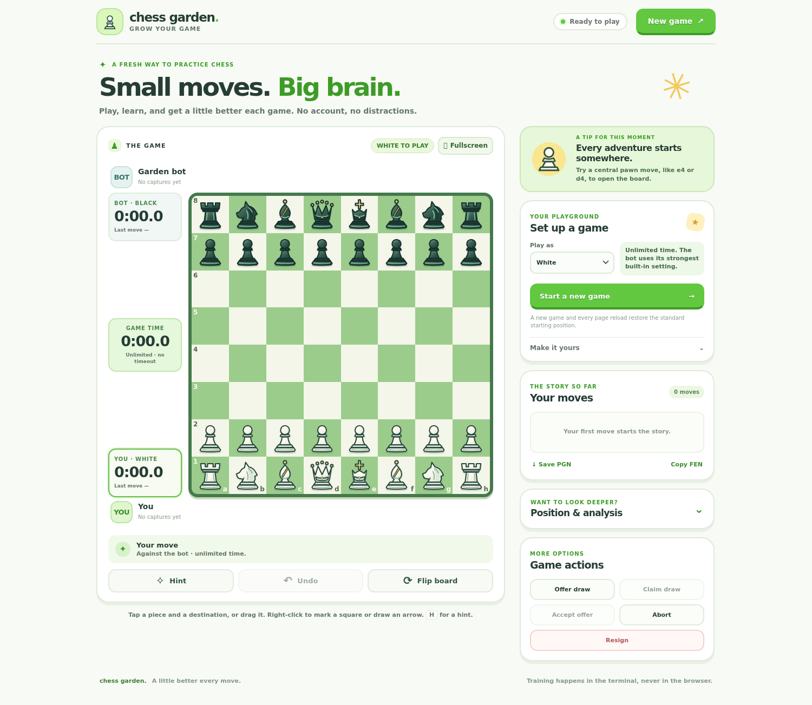

# Chess Garden

A **browser-only, local chess game** with friendly, Duolingo-inspired (not Duolingo-branded) design, original crisp SVG pieces, a rule-authoritative Python server, and **terminal-only** bot training. There is no Tkinter app, training button, CDN, external image/font, account, or cloud engine.



## Play

Python 3.10+ is required. **After one-time setup, `py main.py` (Windows) or `python3 main.py` (Linux) starts the local server and opens the default browser** at http://127.0.0.1:8000/. Keep the terminal open while playing; Ctrl+C stops the server. The launcher automatically uses this repository's `.venv` when it exists, even when you invoke it with the global Python.

**Windows PowerShell (new installation; Git for Windows and the Python launcher required):**

```powershell
git clone https://github.com/jonas050210/Chess.git
cd Chess
.\windows\setup.bat
py main.py
```

If the **`Chess` folder already exists**, `git clone` cannot clone into it. Save any local edits first; from that folder, update the existing checkout instead:

```powershell
cd Chess
git status --short
git fetch origin
git switch main
git pull --ff-only origin main
.\windows\setup.bat
py main.py
```

If `git status --short` shows changes you want to keep, commit or otherwise save them **before** switching/pulling. `windows\start.bat` is an alternative to `py main.py` and also opens the browser. For low-RAM play in PowerShell: `$env:CHESS_LOW_RAM='1'; py main.py` (or `bash ubuntu/lowram.sh` on Linux). This disables continuous analysis; the default search bot's idle RAM savings are small.

**Linux (new installation, from the repository root):**

```bash
python3 -m venv .venv
.venv/bin/python -m pip install -r requirements.txt
python3 main.py
```

For a different port: `PORT=8001 python3 main.py` (PowerShell: `$env:PORT=8001; py main.py`). For an unattended server without opening a browser, set `CHESS_NO_BROWSER=1`, or run `python server.py`. Flask's automatic `.env`/`.flaskenv` loading is deliberately disabled: a Windows PowerShell 5.1 UTF-16 `.env` otherwise makes Flask crash before it starts. Use process environment variables such as `$env:CHESS_LOW_RAM='1'` instead; you do not need to delete an old `.env` to play. The default bind address is **127.0.0.1**. `CHESS_HOST=0.0.0.0` is intended only for trusted networks or the Arena live preview: **this is not an authenticated public service**. Browser games live in memory and disappear on server restart; separate clients have separate games (a cookie plus a session-storage fallback for embedded previews).

### Controls

- Click a piece and a destination, drag a piece, or focus the board and use **arrow keys + Enter**. Legal moves and checks are highlighted. Promotion offers queen, rook, bishop, and knight unless auto-queen is enabled.
- Start a new game as White or Black, choose levels 1–5 and a clock/increment. Undo (a full human/bot turn once the bot replies, or just your pending move while it thinks), hint, board flip, and PGN download are available. Side/clock/increment selections apply to the **next** game; level and appearance update immediately.
- While the bot thinks, you can still undo/new-game or queue a **premove** (executed only if legal after the bot's move). Right-click a square to mark it or drag with the right button to draw an arrow. Escape clears marks/selection and cancels a premove.
- **Shortcuts:** `N` new game, `U` undo, `H` hint, `F` flip, `O` offer draw, `A` abort early, `C` clear marks, `Esc` cancel. The hidden preferences menu contains animation, coordinates, board colors, premove, and local two-player mode.
- Chess rules come from `python-chess`: legal moves, castling, en passant, underpromotion, check/mate/stalemate, automatic fivefold/75-move/insufficient-material draws, **claimable** threefold/50-move draws, agreement, resignation, and clocks. An offer to a friend needs the other side to accept; the bot may accept or decline an offer.

### What the bot actually is

The default playing bot uses an improved **bounded alpha-beta search** with check-aware quiescence, mate scoring, move ordering, material, pawn-structure and king-safety evaluation. This plays more sensible chess than the original unverified small model; it is **not** a grandmaster engine. Levels change depth/time and (at easy levels) slightly relax move choice. Hints use the same local engine. The optional policy/value checkpoint is **not** used in live games simply because a `.npz` file exists: it must have passed the training gate and have a matching SHA-256 approval receipt. Restart the server after promotion. `CHESS_ENGINE=baseline` forces search for comparisons; `CHESS_ENGINE=model` is an explicit experimental override of the approval check.

## Improve the bot (terminal only)

```bash
python ai/train_cli.py --dry-run
python ai/train_cli.py --preset basics --basics-epochs 60 --max-seconds 120 --no-promote
python ai/train_cli.py --preset cpu --max-seconds 900 --eval-games 32
# Optional PyTorch/CUDA training on a suitable machine:
python -m pip install -r requirements-gpu.txt
bash ubuntu/train.sh --preset gpu --device cuda --games 200 --eval-games 32
```

Windows: `windows\train.bat --preset basics --no-promote --max-seconds 120`.

The **basics curriculum** (`ai/lessons.py`) teaches mate-in-one, hanging captures, development, king safety, promotion, en passant and opening moves, plus mechanically verified simple capture/promotion/en-passant examples. Its separate eight held-out positions report *move-prior accuracy*, **not playing strength**. Self-play and tactics training can follow. By default, training writes to ignored `checkpoints/candidates/`; a custom `--out` may choose another non-active candidate path. The active checkpoint is never the direct output of a trainer. Only a successful gate with at least **12 completed paired games**, a conservative 95% lower score/gain, and a held-out fundamentals check may atomically promote a candidate. An invalid move counts as a loss; an unfinished game does **not** count as a draw. If the gate fails, the live bot continues using the reliable search engine. No model was claimed to be strong or automatically promoted merely for passing a few puzzles. Details: [Training guide](docs/TRAINING.md).

## Tests and development

```bash
python -m unittest discover -s tests -v
python -m compileall -q ai server.py main.py tests
npm run test:unit                      # pure browser logic and SVG art; Node 22+
npm ci && npx playwright install chromium
npm run test:e2e                       # real browser, Python server required on PATH
```

CI runs Python tests on 3.10 and 3.12, a Windows PowerShell 5.1 launch check with a UTF-16 `.env`, Node unit tests, and Chromium browser tests covering click/drag/touch play, undo, draws, premoves, promotions, annotations, PGN export, pieces and 360–1440px layouts. The Playwright config starts the server automatically; activate the Python environment before running it locally. For an iframe preview, start with `CHESS_HOST=0.0.0.0 python server.py`; the website calls the API through **relative URLs** only.

| Path | Purpose |
|---|---|
| `web/index.html`, `web/styles.css`, `web/app.js` | Browser UI and responsive interaction |
| `web/pieces.js`, `web/logic.js` | Original scalable art and independently tested board helpers |
| `server.py` | Per-browser sessions, clocks, legal moves, draws, async bot and analysis API |
| `ai/baseline.py`, `ai/bot.py` | Playing search and gated model selection |
| `ai/lessons.py`, `ai/train_basics.py`, `ai/train_cli.py` | Terminal curriculum and guarded training pipeline |
| `ai/mcts.py`, `ai/model.py`, `ai/selfplay.py`, `ai/evaluate.py` | Optional policy/value model, self-play and paired Arena |
| `tests/`, `.github/workflows/tests.yml` | Python, JS and browser regression tests |
| `checkpoints/model.npz` | Existing model retained for comparisons; not approved by default |

### Limits

Chess Garden runs locally, not as a hosted multiplayer product: games are not saved on server restart, no user accounts exist, and opening books/tablebases are not included. GPU training has not been run end-to-end in this sandbox. The held-out lessons are deliberately small and the NumPy model can overfit even the expanded training set; stronger chess needs substantially more high-quality data and completed Arena evidence, not a claim based on training loss alone. See [improvements and next steps](docs/IMPROVEMENTS.md).

No `LICENSE` is present; permission to reuse this code or artwork is not implied without one from the owner.
